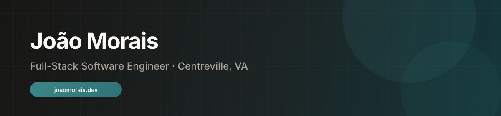

  

 

  

  <a href="https://joaomorais.dev/">joaomorais.dev</a>
  ·
  <a href="https://joaomorais.dev/work/">projects</a>
  ·
  <a href="https://joaomorais.dev/resume.pdf">resume</a>
  ·
  <a href="https://linkedin.com/in/joaomoraisdev">linkedin</a>
  ·
  <a href="mailto:jp.morais800@gmail.com">email</a>

  Full-Stack Software Engineer from Portugal, based in Centreville, VA · US permanent resident (no sponsorship needed) · <b>open to SWE roles</b>

---

### Day job

**Prozis** (Jul 2025 – present) — one of **4 engineers** maintaining **9 internal products** used by ~1.3k employees.

Stuff that actually matters:
- **KPI** — I own it alone. The company's first **agent-first app** (React + Java/Quarkus): anything you can do by clicking, an AI agent can do through chat, calling KPI's actions as tools and asking for permission before it acts
- **Metadata** — building it solo: a Node.js + Svelte **RAG** service that embeds company documents in **Qdrant** to give KPI and future agents context
- Previously owned the **project-management platform**, reporting directly to the CEO — including its engine for scheduled recurring department reports
- SQL Server → PostgreSQL migration (~40 tables; largest ~500k rows), zero-downtime cutover, watched in Grafana

`React` · `Java` · `Quarkus` · `Spring Boot` · `Node.js` · `Svelte` · `Vue 3` · `PostgreSQL` · `Qdrant`

---

### Side projects

| Project | Status | What it is |
|---------|--------|------------|
| **[FlaviNight](https://joaomorais.dev/work/flavinight/)** | in development · private | Nightclub ticketing app for Portugal. Co-founder & sole engineer at FlaviByte — Expo / React Native app, one Cloudflare Worker (Hono, D1, R2), Stripe Connect payouts, signed QR tickets |
| **[Bitácula](https://joaomorais.dev/work/bitacula/)** | in development · private | All-in-one macOS workbench built with a colleague — Rust + Tauri v2 + React/TS; markdown editor, encrypted team vault, Postgres/Kubernetes/Docker/Grafana tools, MCP server for AI agents |
| **[Queima25](https://github.com/JoaoMorais03/Queima25)** | public | Offline iOS party game in Swift + SpriteKit — up to 15 players on one device, five challenge types |

---

### Stack

  

  Also: <code>Quarkus</code> · <code>Hono</code> · <code>Expo / React Native</code> · <code>Qdrant</code> · <code>Cloudflare D1 / R2</code> · <code>Stripe Connect</code> · <code>RAG</code> · <code>MCP</code> · <code>LLM tool use</code>

---

  
  

Private work note

Most of my work (Prozis, FlaviNight, Bitácula) lives in private repos, so it never shows up in these stats. Write-ups live on <a href="https://joaomorais.dev/work/">joaomorais.dev/work</a>.

